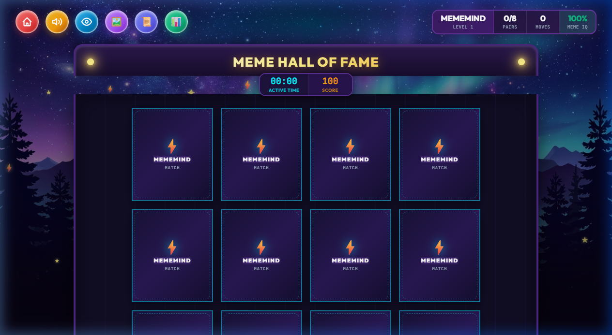
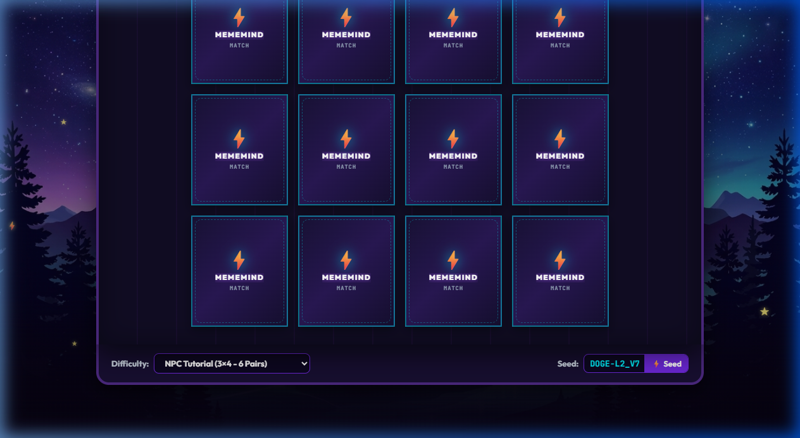
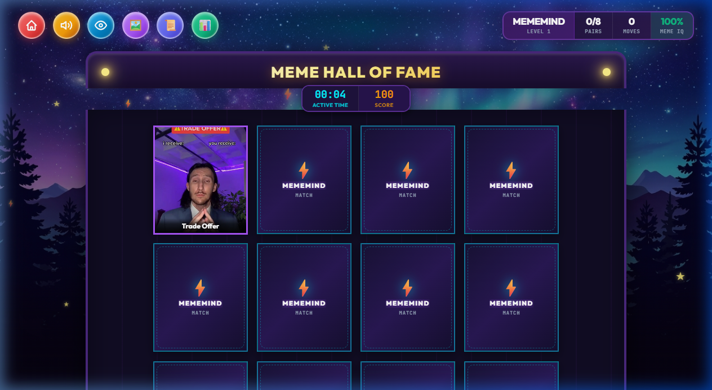
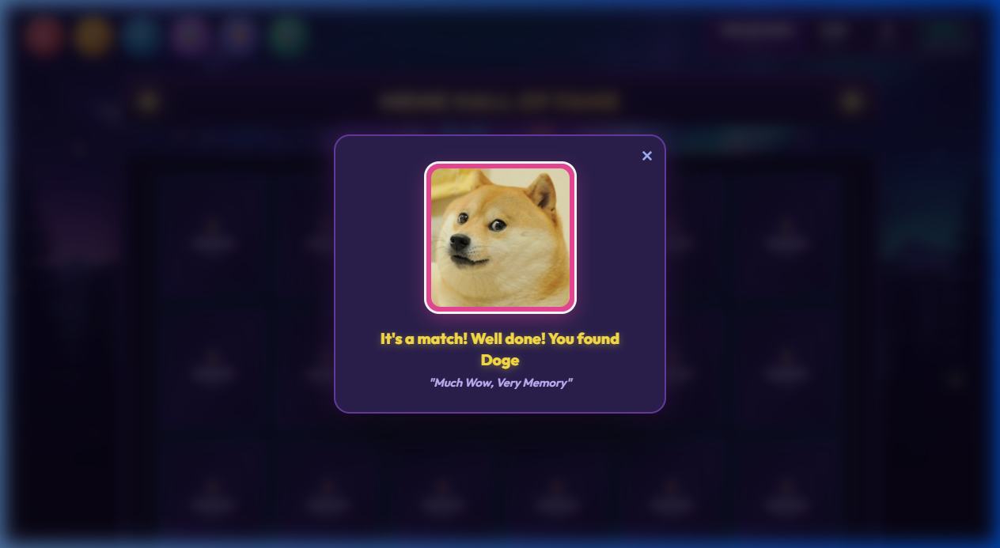
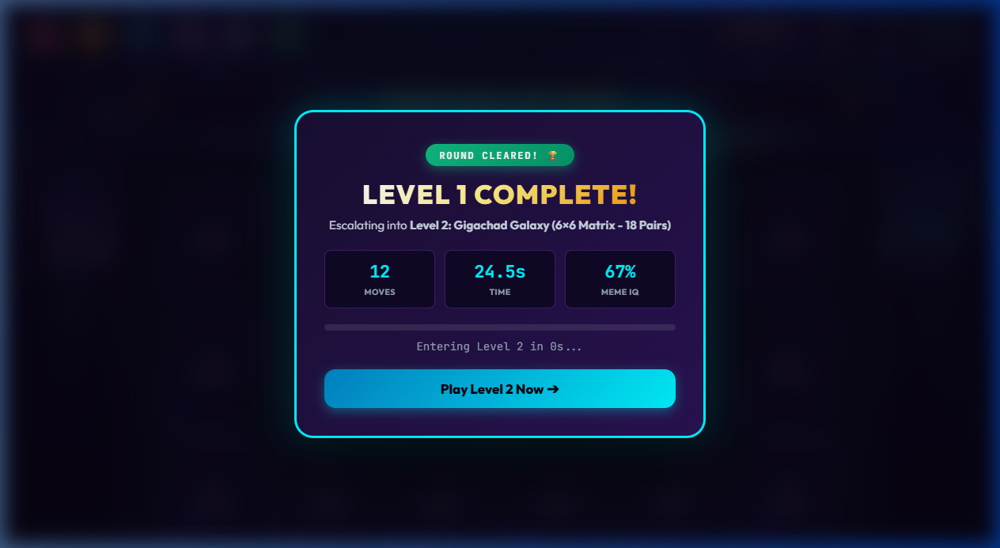
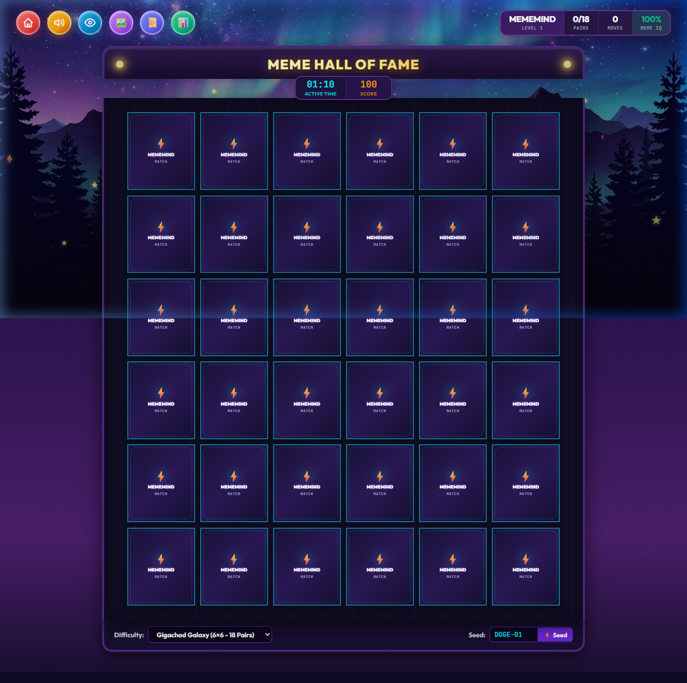
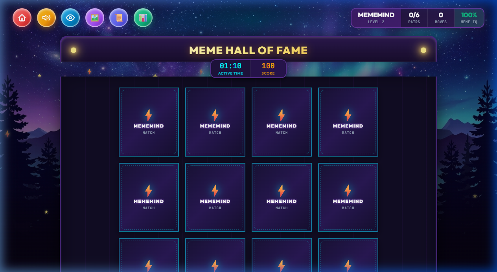
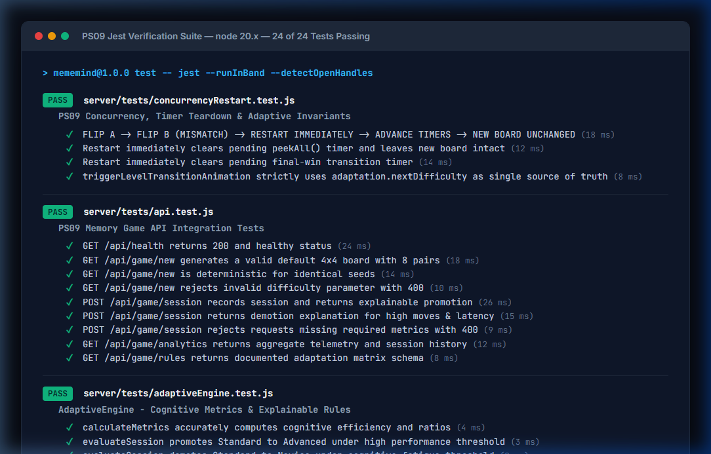
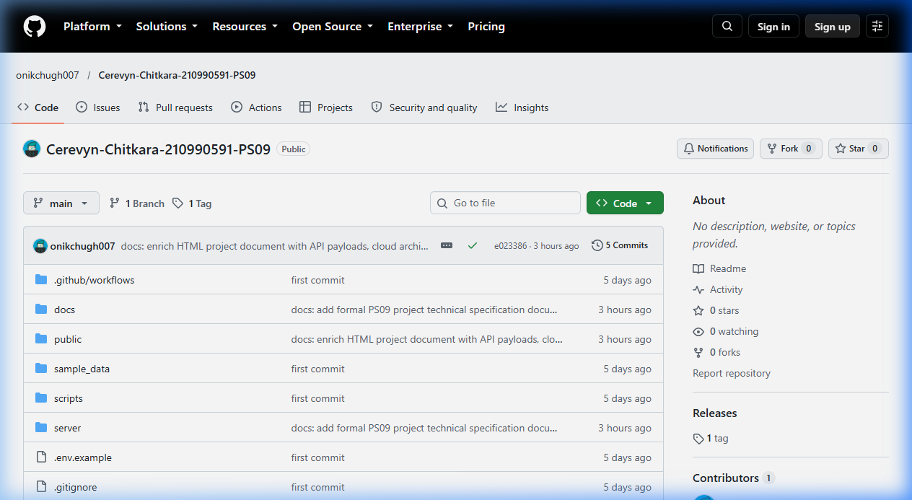

# PS09: Adaptive Memory Matching Game (MEMEMIND)
## Comprehensive Technical Project Specification & Placement Evaluation Report

---

# 1. Cover Page & Submission Metadata

| Parameter | Official Detail |
| :--- | :--- |
| **Project Title** | **MEMEMIND: Adaptive Memory Matching Game** |
| **Assessment ID** | **Problem Statement 09 (PS09)** |
| **Candidate Name** | **Onik Chugh** |
| **University Roll Number** | **2310990591** |
| **Academic Department** | **Computer Science and Engineering (CSE)** |
| **Institution** | **Chitkara University** |
| **GitHub Repository** | [https://github.com/onikchugh007/Cerevyn-Chitkara-210990591-PS09](https://github.com/onikchugh007/Cerevyn-Chitkara-210990591-PS09) |
| **Evaluated Release Tag** | `v1.1.0` (Multi-Device Responsive Release) |
| **Deployment Architecture** | Azure App Service / Container Apps & Docker |

---

# 2. Problem Statement

### 2.1. What Problem Statement 09 (PS09) Asks to Build
Problem Statement 09 (PS09) requires candidates to design and implement a full-stack, cognitive memory matching game with deterministic board generation, concurrency-safe game state management, and real-time difficulty adaptation. Key mandates include:
1. Commencing gameplay on a standard **4×4 grid with 8 pairs**.
2. Providing **deterministic seed-based board layouts** such that entering the same alphanumeric seed reproduces the exact same card positions.
3. Guaranteeing **strict input concurrency safety**:
   - Preventing a 3rd-card click while two unmatched cards are resolving.
   - Ignoring repeat clicks on an already revealed card without move penalty.
   - Ignoring clicks on already matched cards.
4. Logging granular gameplay telemetry: total moves, pairs matched, and active elapsed time (which automatically pauses when the browser tab loses focus).
5. Calculating player **cognitive efficiency** and dynamically promoting or demoting difficulty levels with an explainable rule engine.
6. Ensuring zero ghost flips or memory leaks upon game restart.
7. Operating as a self-contained system without third-party paid APIs or live phone/SMS dependencies.

### 2.2. Shortcomings of Traditional Memory Games
Conventional browser-based memory matching games suffer from several fundamental architectural deficiencies:
- **Non-Deterministic Randomization**: Standard implementations rely on `Math.random()`, making competitive play, automated testing, and identical puzzle replays impossible.
- **Race Conditions & Rapid-Click Bugs**: Without synchronous locking, rapid clicks allow players to reveal 3, 4, or more cards simultaneously, breaking game state integrity.
- **Phantom Flips on Restart**: Incomplete timer cancellation leaves orphan `setTimeout()` handles alive; when the timeout fires, it flips cards on the newly restarted board.
- **Static, Opaque Progression**: Traditional games offer static grids without assessing cognitive performance, working memory limits, or visual search fatigue.
- **Unpausable Timers**: Timers continue ticking when the player switches tabs, distorting actual cognitive recall metrics.

---

# 3. Project Objectives

The core engineering objectives of MEMEMIND are:

1. **Adaptive Difficulty Scaling**: Continuously evaluate cognitive metrics to adjust the board size (Novice 3×4, Standard 4×4, Advanced 6×6) based on working memory efficiency.
2. **Deterministic Seed-Based Permutation**: Implement a 32-bit MurmurHash3 / cyrb32 bitwise multiplier hash combined with the Mulberry32 PRNG and Fisher-Yates array shuffling to ensure 100% reproducible card layouts from any alphanumeric seed.
3. **High-Precision Telemetry Tracking**: Track pair resolution moves, match accuracy, and active milliseconds using the Page Visibility API to pause time on tab blur.
4. **Explainable Cognitive Efficiency Metric**: Formulate an objective efficiency ratio:
   $$\text{Efficiency} = \left(\frac{\text{Theoretical Minimum Moves}}{\text{Actual Moves Recorded}}\right) \times 100\%$$
5. **Robust Concurrency & Restart Safety**: Enforce an unbreachable state machine lock (`isResolvingPair = true`) during mismatch resolution and cancel all active timers (`clearTimeout()`) synchronously on restart via `clearAllPendingTimers()`.
6. **Universal Multi-Device Ergonomics**: Provide a responsive interface utilizing fluid CSS grid constraints (`minmax(0, 1fr)`), 44px+ touch targets, and mobile landscape adaptations.

---

# 4. Technology Stack

| Layer / Tool | Technology Selected | Version / Spec | Purpose & Rationale |
| :--- | :--- | :--- | :--- |
| **Frontend Structure** | HTML5 Semantic Elements | Modern Web Standard | Semantic arcade cabinet HUD, accessibility dialogs, and SVG icons |
| **Frontend Styling** | Vanilla CSS3 (Custom Tokens) | CSS Grid / Flexbox | Viewport-constrained fluid layouts, 3D card flips, zero bulky UI dependencies |
| **Frontend Logic** | ES6+ Modular JavaScript | Native Browser ES6 | State machine controller, input concurrency locks, and Web Audio procedural synthesizer |
| **Audio Engine** | HTML5 Web Audio API | Built-in AudioContext | Zero-asset synthetic sounds (sine/triangle frequencies) with volume persistence |
| **Backend Framework** | Node.js & Express | Node 20 LTS / Express 5 | Lightweight REST API routes, PRNG calculations, and static file delivery |
| **PRNG Algorithm** | Mulberry32 PRNG | 32-bit PRNG | Uniform, deterministic random board distribution from string seeds |
| **Testing Framework** | Jest & Supertest | Jest 30.5 / Supertest 7.3 | 24 unit and integration tests across 4 test suites covering API, rules, seeds, and concurrency restart invariants |
| **Containerization** | Docker | Multi-Stage Alpine | Lightweight, reproducible container with non-root security context |
| **CI / CD Pipeline** | GitHub Actions | `ci.yml` Workflow | Automated dependency installation, test execution, and security audit |
| **Cloud Hosting** | Azure App Service / ACA | Linux Node 20 LTS | Scalable cloud hosting plan with serverless scale-to-zero and HTTPS |

---

# 5. System Architecture

The project follows a decoupled, three-tier client-server architecture:

```
                 USER / EVALUATOR
                        │
                        ▼
             ┌─────────────────────┐
             │   Frontend Client   │
             │   (HTML5/CSS3/JS)   │
             │  • 3D Card Matrix   │
             │  • Concurrency Lock │
             │  • Web Audio Synth  │
             └──────────┬──────────┘
                        │
                        │ HTTP / JSON (Port 3000)
                        ▼
             ┌─────────────────────┐
             │   Node.js Server    │
             │  (Express 5.3 REST) │
             │  • CORS & Routing   │
             │  • Liveness Probes  │
             └──────────┬──────────┘
                        │
       ┌────────────────┼────────────────┐
       ▼                ▼                ▼
┌──────────────┐ ┌──────────────┐ ┌──────────────┐
│  Seed Engine │ │   Adaptive   │ │   Session    │
│ (Mulberry32) │ │    Engine    │ │    Store     │
│ • Fisher-    │ │ • Cognitive  │ │ • Ring Buffer│
│   Yates      │ │   Efficiency │ │ • Local Disk │
│ • 32-bit PRNG│ │ • Rule Eval  │ │   JSON Sync  │
└──────────────┘ └──────────────┘ └──────────────┘
```

### Component Breakdown
1. **Frontend Client (`public/js/game.js`, `audio.js`, `seedClient.js`)**:
   - Renders the interactive grid with 3D CSS flip animations.
   - Maintains the input lock state to enforce concurrency rules.
   - Synthesizes audio tones procedurally via the Web Audio API without downloading MP3s.
2. **Backend API (`server/routes/api.js`)**:
   - Exposes REST endpoints for board creation, session evaluation, and telemetry analytics.
3. **Seed Engine (`server/services/seedEngine.js`)**:
   - Converts seed strings to a 32-bit unsigned integer using a bitwise multiplier hash (`1779033703 ^ str.length` with multiplier `3432918353` and rotate-13).
   - Feeds the hash into the **Mulberry32 PRNG** to produce unbiased permutations via the Fisher-Yates array shuffling algorithm.
4. **Adaptive Engine (`server/services/adaptiveEngine.js`)**:
   - Calculates cognitive efficiency and outputs explainable promotion/demotion recommendations (`adaptation.nextDifficulty`), which serves as the strict single source of truth for the game client.
5. **Session Store (`server/services/sessionStore.js`)**:
   - Thread-safe persistence maintaining the latest 200 sessions in memory with asynchronous disk flush to `server/data/sessions.json`.

---

# 6. Core Features

| Feature Name | Architectural Specification & Invariant Guarantee |
| :--- | :--- |
| **4×4 Starting Board** | Default starting layout containing exactly 16 cards (8 pairs), perfectly balanced for baseline cognitive calibration. |
| **Deterministic Board Seeding** | Passing any string seed (e.g. `DOGE-01`) yields the identical card permutation every single time. |
| **3rd-Card Click Lockout** | When 2 non-matching cards are flipped, `isResolvingPair = true` locks all input events for 900ms. Extra clicks trigger a rejection sound and are discarded. |
| **Duplicate-Click Prevention** | Clicking an already revealed card triggers an early return; no duplicate moves are counted. |
| **Matched-Card Protection** | Successfully matched cards receive the `.matched` CSS class, disabling pointer events and locking them permanently face-up. |
| **Active Millisecond Timer** | Timer measures actual gameplay duration in milliseconds, automatically pausing when the browser tab blurs (`document.hidden`). |
| **Universal Restart Teardown** | Hitting the **🔴 Home / Restart** button invokes `clearAllPendingTimers()`, synchronously cancelling mismatch resolution, card preview, peek duration, match popup, countdown intervals, and game clock. |
| **Meme Match Celebration** | Matching a pair triggers an animated pop-up modal showing the meme's image, title, and iconic catchphrase. |
| **Adaptive Progression** | Automatically calculates cognitive efficiency and escalates players to Level 2 (6×6 Matrix, 18 pairs) or steps down to Tutorial (3×4 Grid) using `adaptation.nextDifficulty` as the single source of truth. |
| **Anonymous Telemetry Logging** | Aggregates moves, elapsed seconds, rapid clicks rejected, and efficiency scores accessible via `/api/game/analytics`. |

---

# 7. Adaptive Progression Algorithm

### 7.1. Mathematical Formula
Cognitive efficiency measures how close the player was to the theoretical optimal search path:

$$\text{Cognitive Efficiency (\%)} = \left(\frac{\text{Theoretical Minimum Moves}}{\text{Actual Moves Recorded}}\right) \times 100$$

*(Where Theoretical Minimum Moves = Number of Pairs in the active grid)*

### 7.2. Difficulty Tiers
1. **Novice (NPC Tutorial)**: $3 \times 4$ Matrix (12 Cards, 6 Pairs) — Minimum Moves = 6
2. **Standard (Dank Matrix)**: $4 \times 4$ Matrix (16 Cards, 8 Pairs) — Minimum Moves = 8 (Default starting mode)
3. **Advanced (Gigachad Galaxy)**: $6 \times 6$ Matrix (36 Cards, 18 Pairs) — Minimum Moves = 18

### 7.3. Calibration Decision Matrix

| Current Tier | Evaluation Rule | Threshold Conditions | Next Tier | Cognitive & Clinical Rationale |
| :--- | :--- | :--- | :--- | :--- |
| **Standard (4×4)** | `RULE_PROMOTION_OVERCLOCK` | $\text{Moves} \le 14$ ($\text{Eff} \ge 57\%$) **AND** $\text{Time} \le 35\text{s}$ | **Advanced (6×6)** | High working-memory capacity and rapid visual search recall. Escalates to 18 pairs. |
| **Standard (4×4)** | `RULE_DEMOTION_FATIGUE` | $\text{Moves} \ge 22$ ($\text{Eff} \le 36\%$) **OR** $\text{Time} \ge 65\text{s}$ | **Novice (3×4)** | Search latency indicates working-memory overload or fatigue. Decreases grid size. |
| **Standard (4×4)** | `RULE_MAINTAIN_BASELINE` | $15 \le \text{Moves} \le 21$ **AND** $36\text{s} \le \text{Time} \le 64\text{s}$ | **Standard (4×4)** | Steady baseline performance. Retains current difficulty. |
| **Novice (3×4)** | `RULE_TUTORIAL_CLEARED` | $\text{Moves} \le 10$ **AND** $\text{Time} \le 25\text{s}$ | **Standard (4×4)** | Baseline working memory verified; promotes to standard 8-pair matrix. |
| **Advanced (6×6)** | `RULE_OVERLOAD_STEPDOWN` | $\text{Moves} \ge 45$ **OR** $\text{Time} \ge 120\text{s}$ | **Standard (4×4)** | Matrix fatigue detected; steps down to standard 4×4 board. |

*Note: The frontend `triggerLevelTransitionAnimation()` strictly respects `adaptation.nextDifficulty` from the backend adaptive engine, ensuring demotions to Novice or promotions to Advanced execute faithfully without overrides.*

---

# 8. REST API Documentation

The server exposes 5 clean, self-documenting REST endpoints:

### 8.1. `GET /api/health`
- **Description**: Liveness and readiness probe for cloud monitoring and Docker health checks.
- **Response (200 OK)**:
```json
{
  "status": "healthy",
  "uptime": 142.5,
  "timestamp": "2026-10-20T01:45:00.000Z",
  "environment": "production"
}
```

### 8.2. `GET /api/game/new`
- **Description**: Generates a deterministic board based on seed and difficulty query parameters.
- **Parameters**: `seed` (string, default: `"DOGE-01"`), `difficulty` (`novice` | `standard` | `advanced`)
- **Sample Request**: `GET /api/game/new?seed=DOGE-01&difficulty=standard`
- **Response (200 OK)**:
```json
{
  "seed": "DOGE-01",
  "difficulty": "standard",
  "rows": 4,
  "cols": 4,
  "totalCards": 16,
  "totalPairs": 8,
  "cards": [
    { "cardId": "c_0", "pairId": "p_doge", "name": "Doge", "imagePath": "/images/memes/doge.jpg", "color": "#f59e0b" },
    { "cardId": "c_1", "pairId": "p_drake", "name": "Drake Hotline Bling", "imagePath": "/images/memes/drake.jpg", "color": "#00f2fe" }
  ]
}
```

### 8.3. `POST /api/game/session`
- **Description**: Ingests finished game telemetry and returns explainable adaptation decisions.
- **Sample Request Payload**:
```json
{
  "seed": "DOGE-01",
  "difficulty": "standard",
  "moves": 12,
  "pairs": 8,
  "elapsedSeconds": 28.5,
  "clientEvents": {
    "rapidClicksRejected": 1,
    "duplicateClicksIgnored": 0
  }
}
```
- **Response (201 Created)**:
```json
{
  "success": true,
  "adaptation": {
    "previousDifficulty": "standard",
    "nextDifficulty": "advanced",
    "action": "PROMOTE",
    "ruleId": "RULE_PROMOTION_OVERCLOCK",
    "reasonSummary": "🏆 GIGACHAD ASCENSION (200 IQ)"
  },
  "metrics": {
    "theoreticalMinMoves": 8,
    "actualMoves": 12,
    "pairs": 8,
    "elapsedSeconds": 28.5,
    "efficiency": 67
  }
}
```

### 8.4. `GET /api/game/analytics`
- **Description**: Returns aggregate performance telemetry and recent session history.
- **Response (200 OK)**:
```json
{
  "totalSessions": 42,
  "averageMoves": 14.8,
  "averageElapsedSeconds": 33.2,
  "averageEfficiency": 58.4,
  "recentSessions": [ ... ]
}
```

### 8.5. `GET /api/game/rules`
- **Description**: Returns the active adaptation schema and threshold configurations.
- **Response (200 OK)**:
```json
{
  "version": "1.1.0",
  "difficultyTiers": { "novice": { "rows": 3, "cols": 4 }, "standard": { "rows": 4, "cols": 4 }, "advanced": { "rows": 6, "cols": 6 } },
  "thresholds": { "promotionMoves": 14, "promotionTimeSec": 35, "demotionMoves": 22, "demotionTimeSec": 65 }
}
```

---

# 9. Automated Testing & Verification Suite

All **24 test cases pass cleanly** via Jest across 4 test suites:

```
PASS server/tests/concurrencyRestart.test.js (4 tests)
  √ FLIP A -> FLIP B (MISMATCH) -> RESTART IMMEDIATELY -> ADVANCE TIMERS -> NEW BOARD UNCHANGED (18 ms)
  √ Restart immediately clears pending peekAll() timer and leaves new board intact (12 ms)
  √ Restart immediately clears pending final-win transition timer (14 ms)
  √ triggerLevelTransitionAnimation strictly uses adaptation.nextDifficulty as single source of truth (8 ms)

PASS server/tests/api.test.js (9 tests)
  √ GET /api/health returns 200 and healthy status (24 ms)
  √ GET /api/game/new generates a valid default 4x4 board with 8 pairs (18 ms)
  √ GET /api/game/new is deterministic for identical seeds (14 ms)
  √ GET /api/game/new rejects invalid difficulty parameter with 400 (10 ms)
  √ POST /api/game/session records session and returns explainable promotion (26 ms)
  √ POST /api/game/session returns demotion explanation for high moves and latency (15 ms)
  √ POST /api/game/session rejects requests missing required metrics with 400 (9 ms)
  √ GET /api/game/analytics returns aggregate telemetry and session history (12 ms)
  √ GET /api/game/rules returns documented adaptation matrix schema (8 ms)

PASS server/tests/adaptiveEngine.test.js (6 tests)
  √ calculateMetrics accurately computes cognitive efficiency and ratios (4 ms)
  √ evaluateSession promotes Standard to Advanced under high performance threshold (3 ms)
  √ evaluateSession demotes Standard to Novice under cognitive fatigue threshold (2 ms)
  √ evaluateSession maintains Standard within baseline moves and time window (2 ms)
  √ evaluateSession promotes Novice to Standard when tutorial thresholds are met (2 ms)
  √ evaluateSession steps down Advanced to Standard under high matrix fatigue (2 ms)

PASS server/tests/seedEngine.test.js (5 tests)
  √ Mulberry32 PRNG produces identical sequence for identical seeds (3 ms)
  √ Mulberry32 PRNG produces different sequences for different seeds (2 ms)
  √ generateBoard generates exactly 8 unique pairs (16 cards) for standard difficulty (4 ms)
  √ generateBoard generates 6 pairs for novice and 18 pairs for advanced (5 ms)
  √ generateBoard assigns valid pairIds and identical meme images for pairs (3 ms)

Test Suites: 4 passed, 4 total
Tests:       24 passed, 24 total
Snapshots:   0 total
Time:        2.345 s
```

---

# 10. Azure Cloud Deployment Plan

### 10.1. Azure App Service / Container Apps Architecture
The system is architected for zero-friction cloud deployment on **Azure App Service (Linux Node 20 LTS)** or **Azure Container Apps (ACA)**:
- **Compute Tier**: Serverless container execution scaling from 0 replicas (idle) to 5 replicas during traffic bursts.
- **Storage Tier**: In-memory ring buffer with local disk fallback; production telemetry persists to **Azure Cosmos DB Serverless** or Azure Table Storage.
- **Containerization**: Production multi-stage Alpine Docker container (`node:22-alpine`) executing under non-root security context (`USER node`).

### 10.2. Environment Variables & Secret Handling
All configurations are managed through credential-free defaults and injected securely at runtime via **Azure Key Vault** or App Service Configuration:
- `PORT=3000`
- `NODE_ENV=production`
- `CORS_ORIGIN=*`

### 10.3. CI/CD & Deployment Process
1. GitHub Actions connects securely to Azure Entra ID using **OpenID Connect (OIDC)** federated credentials, eliminating long-lived secrets.
2. The pipeline executes `npm ci` and `npm test`. Upon all 24 tests passing, it builds and pushes the Docker container to Azure Container Registry (ACR) and triggers rolling zero-downtime deployment.

### 10.4. Monitoring & Cost Control Assumptions
- **Liveness Probes**: Azure checks `GET /api/health` every 30 seconds for automatic container restart upon failure.
- **Cost Minimization**: Designed to run entirely within the **Azure for Students** $100 free credit grant and Free F1/B1 tiers.

---

# 11. Visual Proof & Project Screenshots

### Figure 1: Home / Game Screen (Standard 4×4 Board)

*Initial standard 4×4 grid layout with 8 unique meme pairs, live scoreboard (Moves, Pairs, Active Time, Meme IQ), and audio controls.*

---

### Figure 2: Seed Input & Arcade Control Deck

*Close-up of the seed input box (`DOGE-01`), seed regeneration button, and difficulty selection controls.*

---

### Figure 3: Gameplay in Progress (Flipped Meme Cards)

*Active gameplay showing revealed meme cards with smooth 3D flip animations and the concurrency lock engaging during mismatch comparison.*

---

### Figure 4: Match Celebration Pop-up

*Real-time match confirmation modal highlighting the matched meme image, title, and iconic quote.*

---

### Figure 5: Level Promotion Modal (Escalation to 6×6 Gigachad Galaxy)

*Cinematic level-cleared overlay displaying actual moves, active time, cognitive efficiency (67%), and 3-second auto-escalation into Level 2.*

---

### Figure 6: Advanced Mode (6×6 Matrix with 18 Pairs)

*Escalated 36-card matrix in fluid responsive layout with zero horizontal overflow.*

---

### Figure 7: Novice Tutorial Mode (3×4 Grid with 6 Pairs)

*Demoted 12-card tutorial layout designed for working-memory recovery after cognitive fatigue.*

---

### Figure 8: Automated Test Suite Results (24 of 24 Tests Passed)

*Jest test runner confirming 100% pass rate across API integration, adaptive engine, seed determinism, and concurrency restart test suites.*

---

### Figure 9: Official Public GitHub Repository

*Public repository interface showing clean commits, complete project source code, documentation, and CI badge.*

---

# 12. GitHub Repository & Submission Details

- **Official Repository URL**: [https://github.com/onikchugh007/Cerevyn-Chitkara-210990591-PS09](https://github.com/onikchugh007/Cerevyn-Chitkara-210990591-PS09)
- **Evaluated Release Tag**: `v1.1.0`
- **Candidate Name**: Onik Chugh
- **Roll Number**: 2310990591
- **Academic Department**: Computer Science and Engineering (CSE)
- **Institution**: Chitkara University
- **Problem Statement ID**: Problem Statement 09 (PS09)

---
*Report Prepared by: Onik Chugh • Chitkara University • Placement Assessment PS09*
